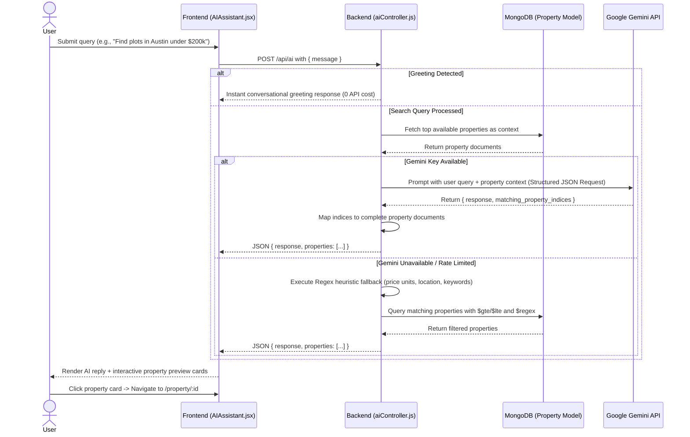

# LandChat Connect: Comprehensive Project Documentation

## 1. Introduction
**LandChat Connect** is a modern, full-stack real estate and land investment web application engineered to streamline how buyers, sellers, and administrators discover, evaluate, and transact land properties.

It combines an intuitive property discovery engine with peer-to-peer messaging and an intelligent, context-aware AI Property Assistant powered by Google's Gemini API. By pairing structured MongoDB collections with an AI-augmented search pipeline (featuring instant regex/heuristic parsing and LLM-driven recommendation matching), LandChat Connect delivers personalized property recommendations, instant budget/location filtering, and seamless inquiry workflows.

---

## 2. Tech Stack

### Frontend
*   **React 18 (via Vite)**: Component-driven, reactive user interface leveraging hooks and context providers.
*   **Vite**: Next-generation frontend tooling offering near-instant dev server spin-up and Hot Module Replacement (HMR).
*   **Tailwind CSS**: Utility-first CSS framework for rapid UI styling, custom themes, responsive breakpoints, and animations.
*   **shadcn/ui & Radix UI Primitives**: Accessible, customizable component primitives (dialogs, dropdowns, scroll-areas, tooltips, accordions, tabs).
*   **TanStack React Query (v5)**: Asynchronous state management, server caching, and background data synchronization.
*   **React Router DOM (v6)**: Declarative, role-based client-side routing with route guards for `customer` and `admin` dashboards.
*   **Lucide React**: Clean, modern SVG icon set for navigation and interactive triggers.
*   **Recharts**: Data visualization for property analytics and visit statistics.

### Backend & Database
*   **Node.js & Express.js**: RESTful API layer handling authentication, property management, messaging, and AI orchestration.
*   **MongoDB & Mongoose (v8)**: Document database and object data modeling (ODM) managing Users, Properties, and Messages with indexing and population.
*   **JWT (JSON Web Tokens) & bcryptjs**: Stateless authentication and secure password hashing.
*   **Express Async Handler**: Graceful asynchronous error wrapping and centralized error handling.

### APIs & Cloud Services
*   **Google Gemini API (`@google/generative-ai`)**: Powers the conversational property recommendation engine by analyzing user queries against real-time database context.

### Why this specific Tech Stack?
*   **Vite over Webpack (CRA)**: Instant startup time and rapid HMR using native ES modules drastically accelerate frontend development.
*   **Tailwind CSS + shadcn/ui**: Provides an accessible, production-grade design system without heavy runtime overhead or vendor lock-in.
*   **MongoDB + Mongoose**: Real estate properties have flexible attributes (varying dimensions, road widths, utilities, approval statuses). A document model accommodates diverse property schemas effortlessly compared to rigid relational tables.
*   **Hybrid AI Design (Rule-based Fallback + Gemini Pro)**: Guarantees zero downtime. If the Gemini API hits quotas or rate limits, the system automatically falls back to regex-driven multi-currency price parsing (`₹`, `lakh`, `cr`, `k`, `under/above`) and location heuristics without degrading user experience.

---

## 3. Architecture and Workflow

The application employs a **Client-Server Decoupled Architecture** augmented by an external AI service.


### End-to-End Workflow:



1.  **User Authentication & RBAC**: Users sign up or log in. The server issues a signed JWT containing the user ID and role (`customer` vs `admin`). The frontend stores the token in `localStorage` and injects it into subsequent Axios requests via interceptors.
2.  **Property Exploration & Management**:
    *   **Public/Buyer**: Browse, filter by location or land type, inspect detailed property pages (facing direction, road width, legal clearance, amenities), schedule visits, and save favorites.
    *   **Admin/Seller**: Create listings, update pricing/status, upload images, inspect view analytics, and manage buyer inquiries.
3.  **Real-Time P2P Messaging**: Buyers can trigger direct inquiries from property pages. Messages link sender, receiver, and the relevant property ID, enabling contextual conversations.
4.  **AI Assistant Workflow**:
    *   The user asks a question in the AI Property Assistant tab.
    *   The backend validates if the query is a simple greeting (handling it with zero latency).
    *   For property discovery queries, available listings are fetched from MongoDB and fed into Gemini Pro with strict instructions to output structured JSON mapping matching property indices.
    *   If Gemini is unavailable or errors out, an intelligent heuristic engine steps in, extracting prices (supporting Lakhs, Crores, K, M, above/under conditions) and locations using regex to query MongoDB directly.

---

## 4. All Libraries Used

**NPM Packages (Frontend)**:
*   `react` & `react-dom` (v18.3.1): UI foundation and reactive rendering.
*   `vite` & `@vitejs/plugin-react-swc`: High-performance development server and Fast Refresh via SWC.
*   `react-router-dom` (v6.30.2): Declarative client-side routing with protected route boundaries.
*   `@tanstack/react-query` (v5.83.0): Data fetching, caching, and server state management.
*   `axios`: HTTP client configured with custom authorization interceptors.
*   `tailwindcss` & `tailwindcss-animate`: Styling and CSS micro-animations.
*   `@radix-ui/react-*`: Complete suite of unstyled, accessible UI primitives (dialogs, dropdowns, popovers, select, tabs, tooltips).
*   `lucide-react`: Modern vector icon library.
*   `recharts`: Charting and statistical visualization for dashboards.
*   `react-hook-form` & `zod` / `@hookform/resolvers`: Schema-based form validation and handling.
*   `sonner`: Toast notification system for user feedback.

**NPM Packages (Backend Server)**:
*   `express` (v4.18.2): Web application framework for REST endpoints.
*   `mongoose` (v8.0.3): MongoDB object modeling and schema validation.
*   `@google/generative-ai` (v0.24.1): Official Google GenAI SDK for Gemini model integration.
*   `jsonwebtoken` (v9.0.2): Token generation and verification for secure API access.
*   `bcryptjs` (v2.4.3): Password hashing with cryptographic salts.
*   `dotenv` (v16.3.1): Environment configuration management.
*   `cors` (v2.8.5): Cross-Origin Resource Sharing middleware.
*   `express-async-handler` (v1.2.0): Asynchronous exception handling middleware.
*   `concurrently`: Enables running both frontend and backend concurrently with a single command.

---

## 5. How Execution and AI Recommendation are Happening

### Execution Flow:
1.  **Frontend Chat Initiation**:
    *   In `src/pages/AIAssistant.jsx`, the user types a prompt or selects a suggestion bubble.
    *   `handleSend` appends the user's message to local state and issues a `POST` request to `/api/ai`.
2.  **Backend AI Controller (`server/controllers/aiController.js`)**:
    *   **Greeting Short-Circuit**: Checks if the query matches conversational greetings (`hi`, `hello`, `hey`). If matched, it immediately returns a static welcome message without consuming AI tokens.
    *   **Context Assembling**: Queries MongoDB for the top 20 active properties (`status: 'available'`), extracting title, price, location, dimensions, land type, and synopsis.
    *   **Prompt Construction & Model Execution**: Calls `gemini-pro` using `@google/generative-ai`. The prompt commands the model to act as a seasoned LandChat real estate advisor and enforce structured JSON output:
        ```json
        {
          "response": "Conversational reply...",
          "matching_property_indices": [1, 3]
        }
        ```
    *   **Data Hydration**: The backend matches the returned 1-based indices back to complete Mongoose property objects and sends `{ response, properties }` back to the frontend.
3.  **UI Card Rendering**:
    *   The frontend renders the AI's natural language response alongside responsive interactive property cards showing title, price, location, and dimensions.
    *   Clicking any card immediately navigates the user to `/property/:id` with full image galleries, seller contact options, and visit scheduling.

---

## 6. How NLP and LLMs are Working and Used

The platform utilizes a multi-tier Natural Language Processing approach:

### Tier 1: Zero-Shot Generative Reasoning (Google Gemini)
*   **Context-Augmented Retrieval (Lightweight RAG)**: Instead of fine-tuning or relying solely on LLM pretraining (which cannot know about newly listed lands), the backend pulls available listings from the database dynamically and injects them as prompt context.
*   **Semantic Constraint Extraction**: The LLM understands implicit needs (e.g., *"I want something peaceful away from the city for farming"* resolves to properties with `land_type: 'Agricultural'` and rural locations).
*   **Structured JSON Contract**: The system prompt strips markdown wrappers and parses pure JSON, allowing the React UI to render rich, interactive UI components directly rather than plain text.

### Tier 2: Heuristic Rule-Based Fallback (Offline NLP & Regex Engine)
When the Gemini API key is absent, depleted, or encounters a network partition, `handleRuleBasedFallback` takes over:
*   **Multi-Currency Price Regex**:
    ```javascript
    /(under|below|max|budget|above|over|min|minimum)\s?(?:rs\.?|₹)?\s?(\d+(?:,\d+)*(?:\.\d+)?)\s*(k|m|lakh|lakhs|lac|lacs|cr|crore|crores)?/i
    ```
    It parses Indian denominations (`lakh`, `crore`) and standard abbreviations (`k`, `m`), applying operator multipliers (`* 100,000` or `* 10,000,000`) to construct accurate Mongoose `$lte` / `$gte` range queries.
*   **Preposition Entity Extraction**: Identifies boundary stop words (`in`, `at`, `near`, `around`) to capture location strings and builds case-insensitive `$regex` filters across `location`, `city`, and `state`.
*   **Keyword Stripping**: Removes conversational noise (`show`, `find`, `want`, `looking`) to match remaining tokens against land types and descriptions.

---

## 7. Role-Based Access Control (RBAC) & Security Architecture

1.  **JWT Authentication**:
    *   Passwords are encrypted with `bcrypt.hash()` using salt rounds before saving to MongoDB.
    *   Upon authentication, the server signs a JWT containing the user's `id`.
    *   The `protect` middleware decodes the token from the `Authorization: Bearer <token>` header and attaches the user document to `req.user`.
2.  **Role Separation (`customer` vs `admin`)**:
    *   **Admin Guard**: The `admin` middleware restricts destructive routes (creating, updating, or deleting listings) exclusively to users where `req.user.role === 'admin'`.
    *   **Frontend Protected Routes**: The `<ProtectedRoute allowedRole="admin">` component in `App.jsx` evaluates `profile.role` and redirects unauthorized users away from restricted management consoles.

---

## 8. Common Interview Questions & Answers

**Q1. What is the architecture of LandChat Connect and how does the AI recommendation pipeline work?**
> **Answer**: LandChat Connect uses a decoupled MERN-style architecture (React + Vite, Node.js + Express, MongoDB) enhanced by the Google Gemini API. When a user asks the AI assistant a question, the server fetches available properties from MongoDB and injects them into a structured prompt sent to Gemini. The model returns natural language commentary alongside an array of matching property indices. These are hydrated into full property objects by the backend and displayed as interactive cards in the frontend.

**Q2. How do you handle LLM rate limits, network outages, or API failures?**
> **Answer**: We built a resilient two-stage fallback system in `aiController.js`. First, simple greetings are intercepted locally, eliminating unnecessary API calls. Second, if the Gemini API fails or runs out of credits, the request automatically falls back to an internal heuristic regex engine. This engine extracts budget thresholds, units (Lakhs, Crores, K), and locations from the query and performs a direct Mongoose search, ensuring 100% uptime for property discovery.

**Q3. Why did you choose MongoDB over a relational database like PostgreSQL for real estate listings?**
> **Answer**: Land listings feature diverse, polymorphic attributes—agricultural land may prioritize soil type, water availability, and survey clearances, whereas commercial plots focus on frontage road width and zoning regulations. MongoDB’s document model naturally accommodates these evolving attributes without requiring complex multi-table joins or schema migrations.

**Q4. How is security and Role-Based Access Control (RBAC) implemented?**
> **Answer**: We enforce security across both tiers. On the backend, passwords are salted and hashed using `bcryptjs`. Endpoints are protected by JWT verification middleware, and administrative operations (such as listing creation or modification) require an `admin` role check. On the frontend, React Router wraps sensitive routes with a `<ProtectedRoute>` component that redirects unauthorized users based on their authenticated token and role.

**Q5. How does the in-app messaging system operate between buyers and sellers?**
> **Answer**: The messaging module uses a Mongoose `Message` model that stores `sender`, `receiver`, `content`, `property` (foreign key reference), and read flags. Inquiries initiated directly from a property page automatically link the property reference, providing both parties with immediate listing context during conversation threads.

**Q6. Why did you choose Vite over Create React App (CRA)?**
> **Answer**: Vite leverages native ES modules in modern browsers and uses esbuild/SWC for transpilation. Unlike Create React App, which packages the entire dependency tree upfront via Webpack, Vite starts the dev server immediately and updates modified modules in milliseconds via Hot Module Replacement (HMR), drastically improving developer productivity and build performance.
